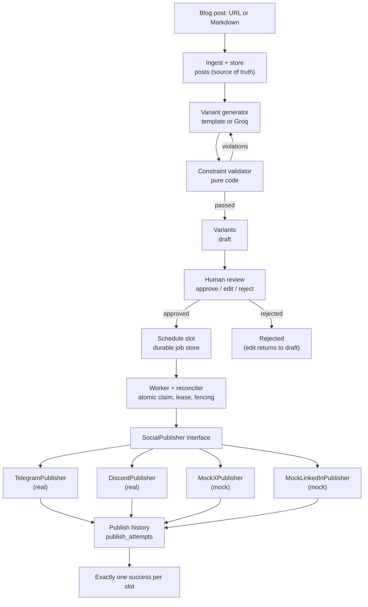
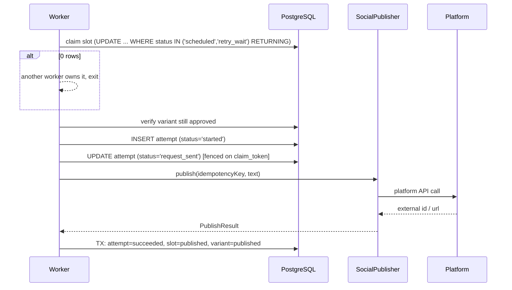
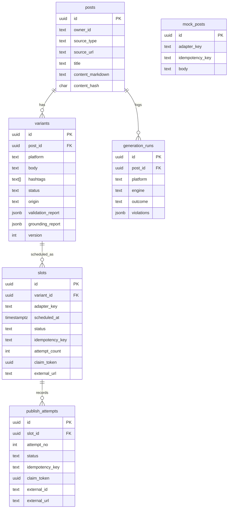
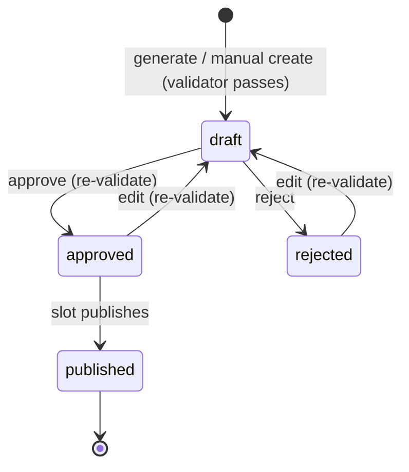
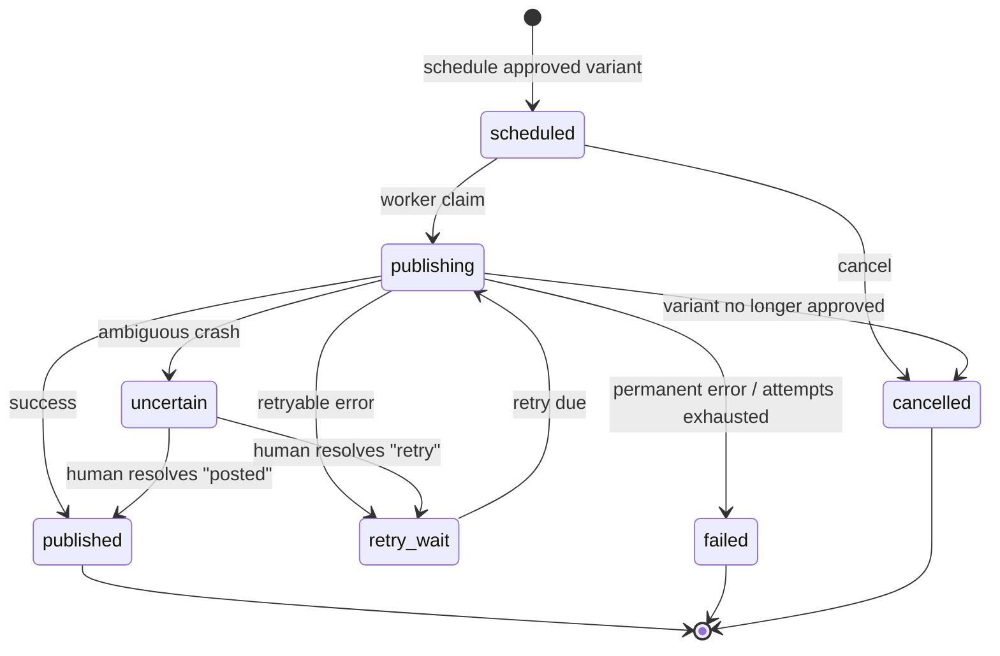
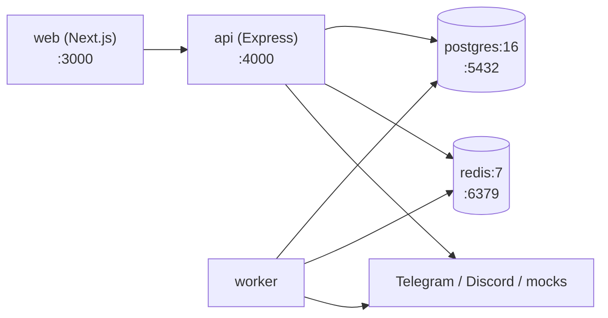

# Architecture

Detailed diagrams for `docs/DESIGN.md`, written in Mermaid.

## 1. System flow



## 2. Publish sequence



## 3. Data model



Full column definitions and constraints: `db/README.md` and `db/migrations/`.

## 4. State machines

### Variant



### Slot



## 5. The adapter seam

```ts
export interface PublishRequest {
  idempotencyKey: string;     // stable per variant + slot
  text: string;
  platform: string;           // profile key, informational
  linkUrl?: string;
  ownerId: string;
}

export interface PublishResult {
  externalId: string;
  externalUrl: string;        // live message link or mock preview link
  raw?: unknown;              // sanitized metadata for debugging
}

export type PublishErrorKind = 'retryable' | 'permanent' | 'ambiguous';

export class PublishError extends Error {
  kind: PublishErrorKind;
  httpStatus?: number;
  retryAfterMs?: number;
}

export interface SocialPublisher {
  readonly key: string;
  readonly supportsIdempotentLookup: boolean;
  publish(req: PublishRequest): Promise<PublishResult>;
  findByIdempotencyKey?(key: string): Promise<PublishResult | null>;
}
```

Registry (the only place adapter names appear):

```ts
const registry: Record<string, () => SocialPublisher> = {
  telegram: () => new TelegramPublisher(env),
  discord: () => new DiscordPublisher(env),
  mock_x: () => new MockPublisher('mock_x', db),
  mock_linkedin: () => new MockPublisher('mock_linkedin', db),
};
```

`config/platforms.json` maps each platform to an adapter key. Business code calls
`resolvePublisher(adapterKey)` and never branches on platform names.

## 6. Idempotency layers

| Layer | Mechanism | Prevents |
|---|---|---|
| L1 | `UNIQUE(idempotency_key)` on `slots`; one active slot per variant | duplicate slots from double-clicks or retried API calls |
| L2 | BullMQ `jobId = {slotId}_{attempt_count}` | enqueueing the same attempt twice |
| L3 | Atomic claim `UPDATE ... WHERE status IN ('scheduled','retry_wait')` + `claim_token` fencing | two workers processing the same slot |
| L4 | Partial unique index: one `succeeded` attempt per slot | recording a second success |
| L5 | `UNIQUE(idempotency_key)` on `mock_posts` | duplicate mock posts |

Every write after the claim is conditional on the `claim_token`. Zero rows affected means the
lease was lost: stop and never call the adapter.

## 7. Crash recovery

| Crash point | State left behind | Recovery |
|---|---|---|
| Before claim | slot `scheduled` | job redelivered → one post |
| After claim, before `request_sent` | slot `publishing`, attempt `started` | lease expires → reconciler resets to `retry_wait` → one post |
| After `request_sent`, before result | slot `publishing`, attempt `request_sent` | mocks: lookup by key → one post. Real adapters: `uncertain` → human resolve, never a duplicate |
| After result recorded | slot `published` | redelivery is a no-op (claim returns 0 rows) |
| Redis wiped | slots `scheduled` in Postgres | reconciler re-enqueues due slots |
| Duplicate job delivery | — | second claim returns 0 rows |

## 8. Layering

```
HTTP routes  →  services  →  repositories  →  PostgreSQL
                   │
                   └──►  SocialPublisher registry  ──►  adapters
worker  →  BullMQ (wake-ups only)  →  same services/repositories
```

Rules:

- Routes contain no business logic.
- Services never import concrete adapter implementations, only the interface and registry.
- Repositories hold all SQL.
- Every user-facing query filters by `owner_id`; cross-owner access returns `404`.
- PostgreSQL is the source of truth; Redis/BullMQ only provides wake-ups.

## 9. Deployment



Docker Compose runs `postgres`, `redis`, `api`, `worker`, and `web`. The API applies
migrations on start; the seed script creates the demo user and sample content.
